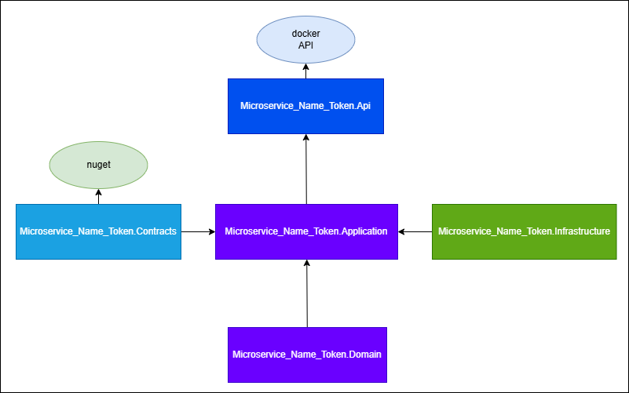

# TEMPLATE

The project template can be used to generate a new microservice with the clean architecture structure:



To use the template is mandatory to import the template:

1. launch a new cmd.
2. cd dotnet-clean-architecture-template folder path.
3. launch the following command to import templates:

    ```bash
    dotnet new install Microservice.Common.Template
    ```

4. Once yuo import the current template you can use it for:

    ```bash
    dotnet new dotnet-clean-architecture-template -n "name of the microservice you want to create (upper first letter)" -o "target path where u want to place the new microservice"
    ```

    example:

    ```bash
    dotnet new dotnet-clean-architecture-template -n "MyAPIService" -o "C:\$GIT\$REPO"
    ```
